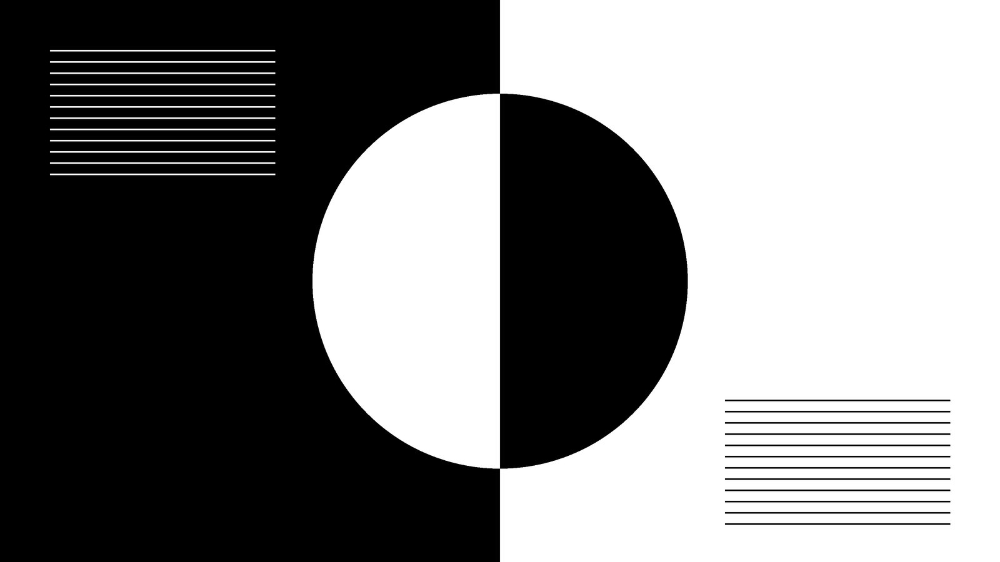

Tulisan ini berisi contoh semua elemen Markdown yang didukung tema ini. Pakai sebagai acuan saat menulis, lalu hapus kalau sudah tidak perlu.

## Teks

Paragraf biasa dengan **teks tebal**, *teks miring*, `kode inline`, dan [tautan ke situs lain](https://gohugo.io/). Paragraf panjang otomatis dibatasi lebarnya supaya tetap nyaman dibaca, baik di layar HP maupun desktop.

### Daftar

- Setiap tulisan adalah file Markdown
- Satu tulisan = satu folder
  - gambar disimpan di folder yang sama
- Push ke GitHub, situs otomatis diperbarui

1. Buat folder baru di `content/blog/`
2. Tulis `index.id.md`, dan `index.en.md` untuk versi English
3. Commit lalu push

## Kutipan

> Ini contoh kutipan. Cocok untuk menyorot kalimat penting atau mengutip sumber lain.

## Kode

Blok kode bisa digeser ke samping di layar kecil:

```bash
# buat tulisan baru (versi Indonesia)
hugo new content blog/judul-tulisan/index.id.md

# jalankan server lokal di http://localhost:1313
hugo server --buildDrafts
```

```go
package main

import "fmt"

func main() {
	// cetak salam ke terminal
	pesan := "Halo, Dunia!"
	fmt.Println(pesan)
}
```

## Tabel

| Elemen  | Sintaks Markdown                  |
| ------- | --------------------------------- |
| Tebal   | `**teks**`                        |
| Miring  | `*teks*`                          |
| Tautan  | `[teks](https://contoh.com)`      |
| Gambar  | `` |

## Gambar



## Catatan kaki

Catatan kaki juga didukung.[^1]

[^1]: Seperti ini. Catatan kaki tampil di bagian bawah tulisan.

---

Selesai. Hapus tulisan ini kalau sudah tidak dibutuhkan.
