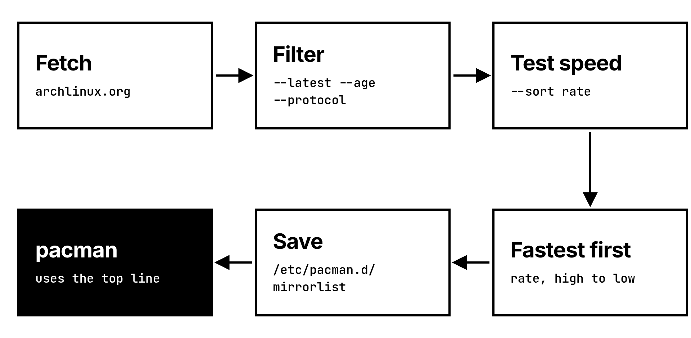
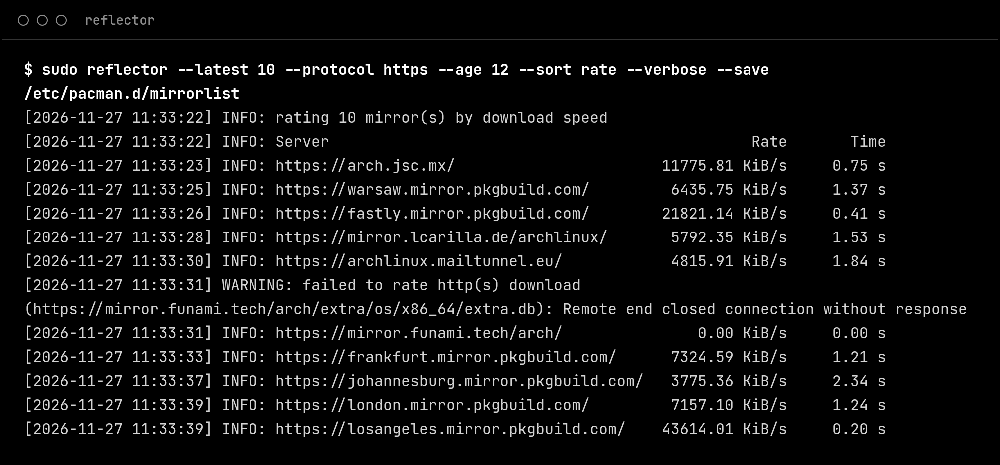
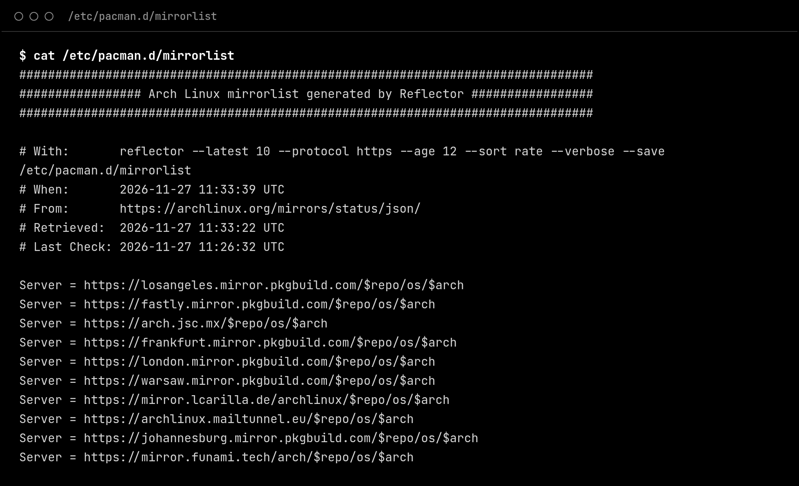

pacman downloads packages from the mirrors listed in `/etc/pacman.d/mirrorlist`, starting with the first line. If the top mirror is slow or out of sync, updates crawl along or fail.

Reflector fixes the order. It fetches the mirror list from archlinux.org, keeps the recently synced mirrors, measures how fast each one downloads, and rewrites that file with the fastest at the top.



pacman's default list now starts with worldwide CDN mirrors that pick a server near you, so it may already be fast enough. Reflector helps when downloads are still slow, keep failing, or you want the list refreshed automatically.

## Install reflector and back up the old list

```bash
sudo pacman -S reflector
sudo cp /etc/pacman.d/mirrorlist /etc/pacman.d/mirrorlist.backup
```

If you don't like the result, copy `mirrorlist.backup` back over `mirrorlist`.

## Test and sort the mirrors

```bash
sudo reflector --latest 10 --protocol https --age 12 --sort rate --verbose --save /etc/pacman.d/mirrorlist
```

This takes the 10 most recently synced HTTPS mirrors (synced within the last 12 hours), downloads the `extra.db` file from each one, and saves the list fastest first. `--verbose` prints the test results.



On the server I tested from, it took about 17 seconds. The fastest mirror, losangeles.mirror.pkgbuild.com at 42.6 MiB/s, moved to the first line. A mirror that failed the test is listed at 0.00 KiB/s and goes to the bottom, so pacman only tries it when every mirror above it fails.

The numbers change from run to run. Three minutes earlier, the same test put fastly.mirror.pkgbuild.com first.



## Update the system

```bash
sudo pacman -Syu
```

If pacman was failing because the old mirror was broken, force a fresh download of the package lists with `sudo pacman -Syyu`.

## Should you filter by country?

`--country` limits mirrors to certain countries, and `reflector --list-countries` shows the choices. The Arch Wiki advises against this filter, because a single country has a limited number of mirrors and speed depends on more than distance.

Reflector lists 7 servers in Indonesia, but when I tried `--country Indonesia --protocol https`, only 2 were left. One timed out after 5 seconds and the other reached 4.4 MiB/s. Results from another location will differ, so test from your own connection.

## Run it every week

Reflector comes with `reflector.timer`, which runs it once a week with the options in `/etc/xdg/reflector/reflector.conf`. The default file picks the 5 most recently synced HTTPS mirrors and sorts them by sync time (`--sort age`). To sort by speed like the command above, replace its contents with:

```
--save /etc/pacman.d/mirrorlist
--protocol https
--latest 10
--age 12
--sort rate
```

Then enable the timer:

```bash
sudo systemctl enable --now reflector.timer
```

To refresh the list outside the schedule, run `sudo systemctl start reflector.service`.
