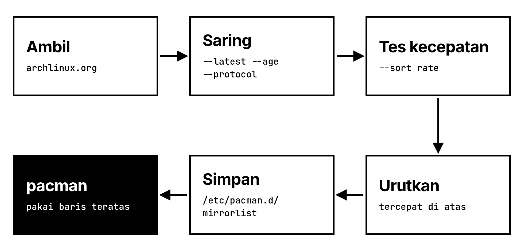
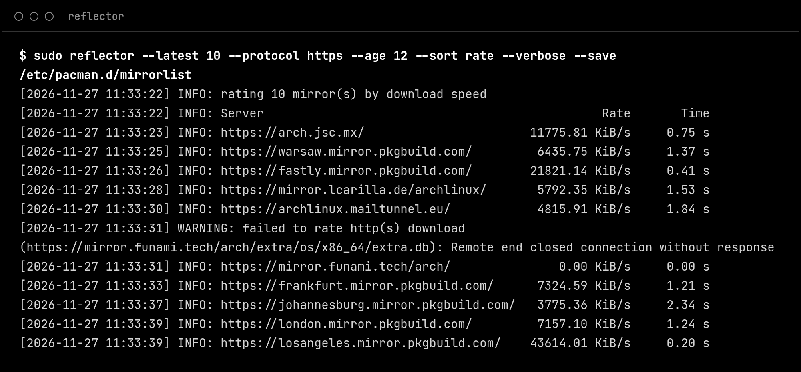
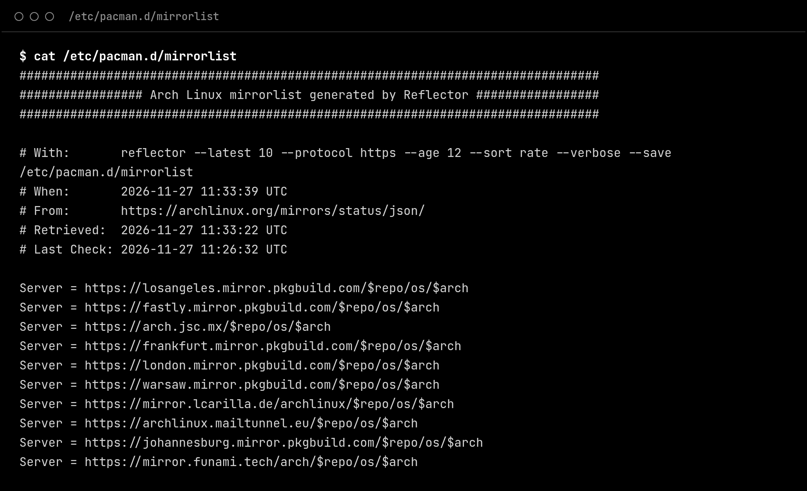

pacman mengunduh paket dari mirror yang tercantum di `/etc/pacman.d/mirrorlist`, dimulai dari baris paling atas. Kalau mirror teratas lambat atau tertinggal sinkron, update ikut lambat, bahkan bisa gagal.

Reflector membereskan urutan itu. Ia mengambil daftar mirror dari archlinux.org, menyaring yang baru sinkron, mengetes kecepatan unduh masing-masing, lalu menulis ulang file tadi dengan yang tercepat di atas.



Daftar bawaan pacman sekarang dibuka dengan mirror global berbasis CDN yang otomatis memilih server dekat kamu, jadi bisa saja sudah cukup cepat. Reflector berguna kalau unduhanmu tetap lambat, sering gagal, atau kamu ingin daftarnya diperbarui otomatis.

## Pasang reflector dan cadangkan daftar lama

```bash
sudo pacman -S reflector
sudo cp /etc/pacman.d/mirrorlist /etc/pacman.d/mirrorlist.backup
```

Kalau hasilnya nanti tidak cocok, salin `mirrorlist.backup` kembali ke `mirrorlist`.

## Tes dan urutkan mirror

```bash
sudo reflector --latest 10 --protocol https --age 12 --sort rate --verbose --save /etc/pacman.d/mirrorlist
```

Perintah ini mengambil 10 mirror HTTPS yang paling baru sinkron (paling lama 12 jam lalu), mengunduh file `extra.db` dari masing-masing, lalu menyimpan daftarnya urut dari yang tercepat. `--verbose` menampilkan hasil tesnya.



Di server tempat saya mengetes, prosesnya sekitar 17 detik. Mirror tercepat, losangeles.mirror.pkgbuild.com dengan 42,6 MiB/s, naik ke baris pertama. Mirror yang gagal dites tercatat 0,00 KiB/s dan ditaruh paling bawah, jadi pacman baru mencobanya kalau semua mirror di atasnya gagal.

Angkanya berubah dari waktu ke waktu. Tiga menit sebelumnya, tes yang sama menaruh fastly.mirror.pkgbuild.com di urutan pertama.



## Perbarui sistem

```bash
sudo pacman -Syu
```

Kalau sebelumnya pacman error karena mirror lama rusak, paksa unduh ulang daftar paket dengan `sudo pacman -Syyu`.

## Perlu filter negara?

`--country` membatasi mirror ke negara tertentu, dan `reflector --list-countries` menampilkan pilihannya. Wiki Arch tidak menyarankan filter ini, karena jumlah mirror di satu negara terbatas dan kecepatan tidak hanya ditentukan jarak.

Daftar reflector mencatat 7 server di Indonesia, tapi waktu saya coba `--country Indonesia --protocol https`, hanya 2 yang tersisa. Satu timeout setelah 5 detik, satunya lagi mencapai 4,4 MiB/s. Dari lokasi lain hasilnya bisa berbeda, jadi tes dari koneksimu sendiri.

## Jalankan otomatis tiap minggu

Reflector menyertakan `reflector.timer`, yang menjalankannya seminggu sekali dengan opsi dari `/etc/xdg/reflector/reflector.conf`. Isi bawaan file itu memilih 5 mirror HTTPS terbaru dan mengurutkannya berdasarkan waktu sinkron (`--sort age`). Supaya diurutkan berdasarkan kecepatan seperti perintah tadi, ganti isinya jadi:

```
--save /etc/pacman.d/mirrorlist
--protocol https
--latest 10
--age 12
--sort rate
```

Lalu aktifkan timernya:

```bash
sudo systemctl enable --now reflector.timer
```

Untuk memperbarui daftar di luar jadwal, jalankan `sudo systemctl start reflector.service`.
