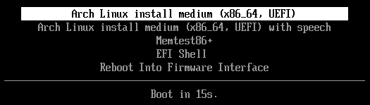
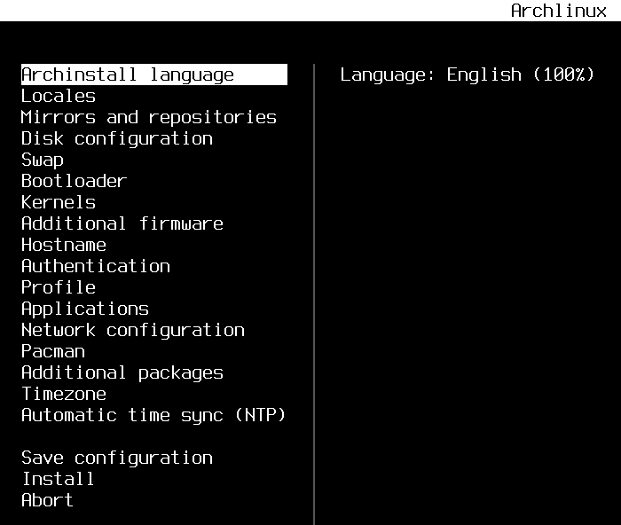
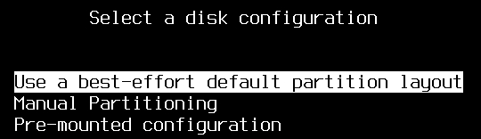
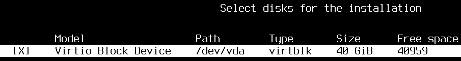
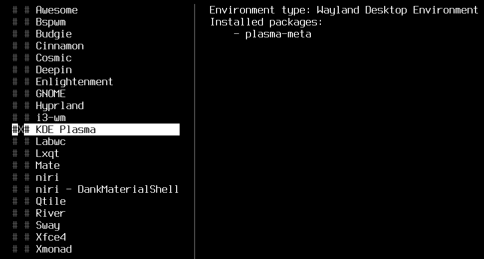
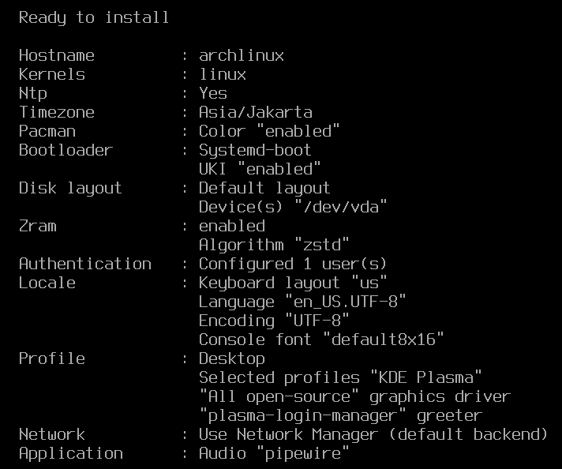

The operating system I use is **Arch Linux**. Arch is known for its manual installation, but the installation image now includes **archinstall**, a menu-based installer that asks a few questions and does the rest. This note is the short version, from downloading the ISO to the first boot.

All the screenshots below come from the 2026.11.01 ISO with archinstall 4.5, shown in black and white. Newer versions may have slightly different menus.

## What you need

- A 64-bit (x86_64) computer. The disk you pick will be **completely erased**, so back up your data first.
- A USB flash drive of at least 2 GB (the ISO is about 1.3 GB). It gets erased too.
- An internet connection, wired or Wi-Fi. archinstall downloads packages during the installation.

## 1. Download the ISO

Download the latest ISO from [archlinux.org/download](https://archlinux.org/download/), using a mirror close to you. To make sure the file is intact, compare its checksum with the one on the download page:

```bash
sha256sum archlinux-2026.11.01-x86_64.iso
```

## 2. Write the ISO to a USB drive

On Linux, find the drive's name with `lsblk`, then write the ISO. Replace `/dev/sdX` with your drive and double-check it, because everything on it will be overwritten:

```bash
sudo dd bs=4M if=archlinux-2026.11.01-x86_64.iso of=/dev/sdX conv=fsync oflag=direct status=progress
```

On Windows, use [Rufus](https://rufus.ie/): pick the ISO and the drive, then click **START**. If the drive doesn't boot, write it again in **DD Image** mode.

## 3. Boot from the USB drive

Turn off **Secure Boot** in the BIOS/UEFI settings, because the Arch installation image doesn't support it. Then boot from the USB drive through the boot menu (the key depends on the brand, often F12, F11, F10 or Esc) and choose **Arch Linux install medium (x86_64, UEFI)**.



After a moment you're logged in as root at a `root@archiso ~ #` prompt. If the text is tiny on a high-resolution screen, enlarge it with `setfont ter-132b`.

## 4. Connect to the internet

A network cable just works. For Wi-Fi, use `iwctl`. Replace `wlan0` with the device name from the first command:

```bash
iwctl device list
iwctl station wlan0 scan
iwctl station wlan0 get-networks
iwctl --passphrase "password" station wlan0 connect "Network-name"
```

Check the connection:

```bash
ping -c 3 ping.archlinux.org
```

## 5. Start archinstall

```bash
archinstall
```



Move with the arrow keys, open an item with Enter, go back with Esc, and press `/` to search long lists. If your ISO is a few weeks old, update archinstall first with `pacman -Sy archinstall`.

## 6. Fill in the menu

Most items can stay at their defaults. These are the ones to set:

**Mirrors and repositories** → **Select regions** → mark your country with Space for faster downloads.

**Disk configuration** → **Partitioning** → **Use a best-effort default partition layout**. Mark the target disk with Space, press Enter, then choose a filesystem: **ext4** to keep it simple, or **btrfs** if you want snapshots.





**Authentication** → **User account** → **Add a user**. Enter a username and password, and answer **Yes** when asked whether the user should be a superuser (sudo). You can set a **Root password** too; if you leave it empty, the root account is disabled and you use sudo.

**Profile** → **Type** → **Desktop**, then mark the desktop you want, such as GNOME or KDE Plasma. Back in the Profile menu, set **Graphics driver** for your graphics card: **All open-source** is safe for Intel and AMD, while NVIDIA GTX 16 or RTX 20 series and newer should use **Nvidia (open kernel module…)**.



**Applications** → **Audio** → **pipewire**. The default is "No audio server", which means no sound.

**Network configuration** → **Use Network Manager (default backend)**. Without it, the installed system has no network set up.

**Timezone**: press `/`, type your city, and pick it from the list, for example **Asia/Jakarta**.

## 7. Install

Move to **Install**. The right panel shows a summary of everything you picked; check that it says **Ready to install** with no warnings.



Press Enter and choose **Yes**. archinstall downloads and installs everything; how long it takes depends on your internet speed. When it says **Installation completed**, choose **Reboot system** and unplug the USB drive while the computer restarts. Next you'll see your desktop's login screen.

## After the first boot

Update the system:

```bash
sudo pacman -Syu
```

For everything else, the best reference is the [Arch Wiki](https://wiki.archlinux.org/).
