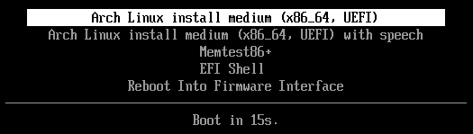
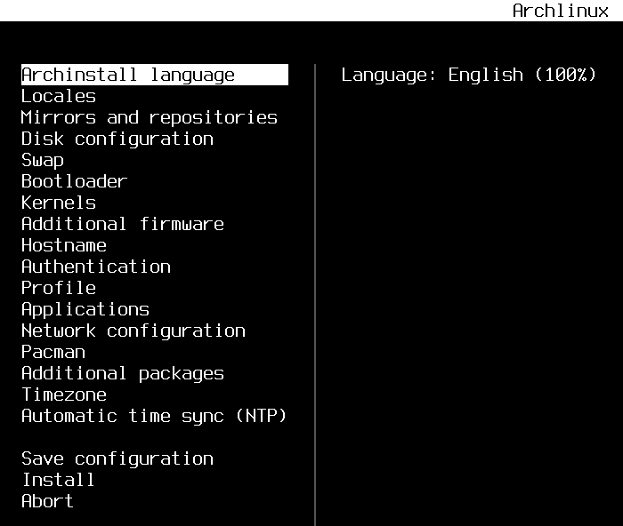
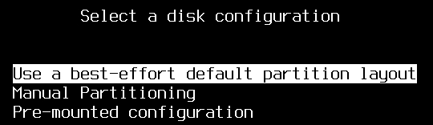
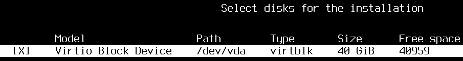
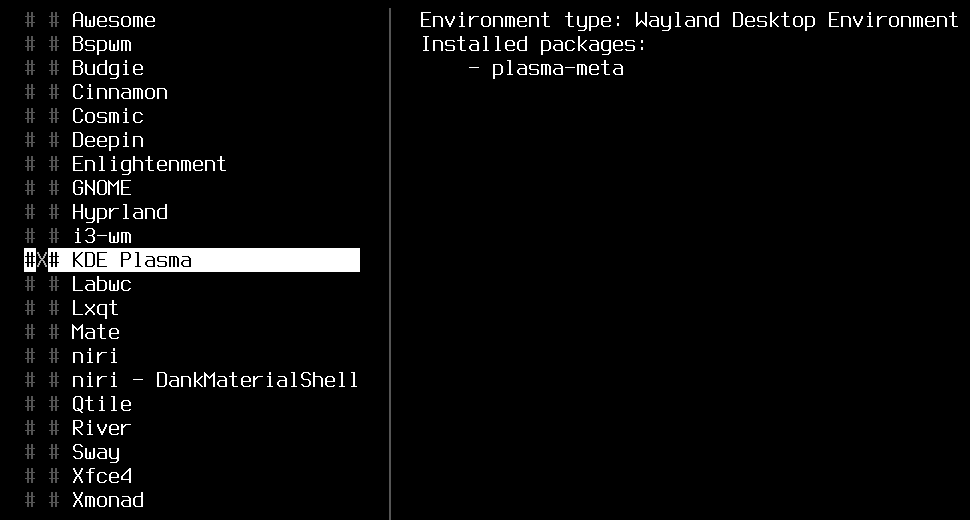
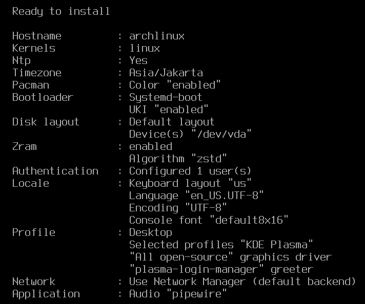

Sistem operasi yang saya pakai adalah **Arch Linux**. Arch dikenal dengan instalasi manualnya, tapi sekarang image instalasinya sudah menyertakan **archinstall**, installer berbasis menu yang menanyakan beberapa hal lalu mengerjakan sisanya. Catatan ini versi singkatnya: dari unduh ISO sampai booting pertama.

Semua gambar di bawah diambil dari ISO 2026.11.01 dengan archinstall 4.5, ditampilkan hitam-putih. Di versi yang lebih baru, menunya bisa sedikit berbeda.

## Yang perlu disiapkan

- Komputer 64-bit (x86_64). Disk yang dipilih nanti akan **dihapus total**, jadi cadangkan dulu datamu.
- Flashdisk minimal 2 GB (ISO-nya sekitar 1,3 GB). Isinya juga akan terhapus.
- Koneksi internet, lewat kabel atau Wi-Fi. archinstall mengunduh paket saat instalasi.

## 1. Unduh ISO

Unduh ISO terbaru dari [archlinux.org/download](https://archlinux.org/download/) lewat mirror terdekat. Supaya yakin filenya utuh, cocokkan checksum-nya dengan yang tertera di halaman unduhan:

```bash
sha256sum archlinux-2026.11.01-x86_64.iso
```

## 2. Tulis ISO ke flashdisk

Di Linux, cari nama flashdisk dengan `lsblk`, lalu tulis ISO-nya. Ganti `/dev/sdX` dengan flashdisk kamu dan pastikan benar, karena semua isinya akan ditimpa:

```bash
sudo dd bs=4M if=archlinux-2026.11.01-x86_64.iso of=/dev/sdX conv=fsync oflag=direct status=progress
```

Di Windows, pakai [Rufus](https://rufus.ie/): pilih ISO dan flashdisk, lalu klik **START**. Kalau flashdisk-nya tidak mau boot, tulis ulang dengan mode **DD Image**.

## 3. Boot dari flashdisk

Matikan **Secure Boot** di pengaturan BIOS/UEFI, karena image instalasi Arch tidak mendukungnya. Lalu boot dari flashdisk lewat menu boot (tombolnya tergantung merek, biasanya F12, F11, F10, atau Esc) dan pilih **Arch Linux install medium (x86_64, UEFI)**.



Setelah beberapa saat, kamu sudah masuk sebagai root dengan prompt `root@archiso ~ #`. Kalau tulisannya terlalu kecil di layar beresolusi tinggi, perbesar dengan `setfont ter-132b`.

## 4. Sambungkan internet

Kabel LAN langsung tersambung sendiri. Untuk Wi-Fi, pakai `iwctl`. Ganti `wlan0` dengan nama perangkat dari perintah pertama:

```bash
iwctl device list
iwctl station wlan0 scan
iwctl station wlan0 get-networks
iwctl --passphrase "kata-sandi" station wlan0 connect "Nama-WiFi"
```

Cek koneksinya:

```bash
ping -c 3 ping.archlinux.org
```

## 5. Jalankan archinstall

```bash
archinstall
```



Gunakan tombol panah untuk bergerak, Enter untuk membuka, Esc untuk kembali, dan `/` untuk mencari di daftar yang panjang. Kalau ISO-mu sudah agak lama, perbarui archinstall dulu dengan `pacman -Sy archinstall`.

## 6. Isi menunya

Sebagian besar bisa dibiarkan default. Yang perlu diisi:

**Mirrors and repositories** → **Select regions** → tandai **Indonesia** dengan Spasi, supaya unduhan lebih cepat.

**Disk configuration** → **Partitioning** → **Use a best-effort default partition layout**. Tandai disk tujuan dengan Spasi, tekan Enter, lalu pilih filesystem: **ext4** kalau mau simpel, **btrfs** kalau mau fitur snapshot.





**Authentication** → **User account** → **Add a user**. Isi nama pengguna dan kata sandi, lalu jawab **Yes** saat ditanya apakah pengguna itu superuser (sudo). **Root password** boleh diisi juga; kalau dikosongkan, akun root dinonaktifkan dan kamu memakai sudo.

**Profile** → **Type** → **Desktop**, lalu tandai desktop yang kamu mau, misalnya GNOME atau KDE Plasma. Kembali di menu Profile, pilih **Graphics driver** sesuai kartu grafis: **All open-source** aman untuk Intel dan AMD, sedangkan untuk NVIDIA seri GTX 16 atau RTX 20 ke atas pilih **Nvidia (open kernel module…)**.



**Applications** → **Audio** → **pipewire**. Defaultnya "No audio server", artinya tidak ada suara.

**Network configuration** → **Use Network Manager (default backend)**. Tanpa ini, sistem yang terpasang tidak punya pengaturan jaringan.

**Timezone**: tekan `/`, ketik `Jakarta`, lalu pilih **Asia/Jakarta**.

## 7. Install

Arahkan ke **Install**. Panel kanan menampilkan ringkasan semua pilihan; pastikan tertulis **Ready to install** tanpa peringatan.



Tekan Enter, lalu pilih **Yes**. archinstall akan mengunduh dan memasang semuanya; lamanya tergantung kecepatan internet. Setelah muncul **Installation completed**, pilih **Reboot system** dan cabut flashdisk saat komputer menyala ulang. Berikutnya kamu akan disambut layar login desktop.

## Setelah boot pertama

Perbarui sistem:

```bash
sudo pacman -Syu
```

Untuk hal lain, rujukan terbaik adalah [Arch Wiki](https://wiki.archlinux.org/).
